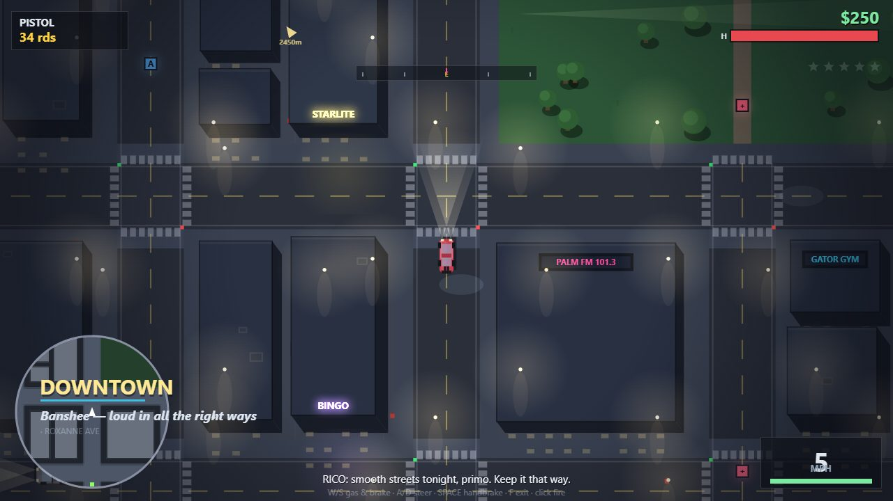
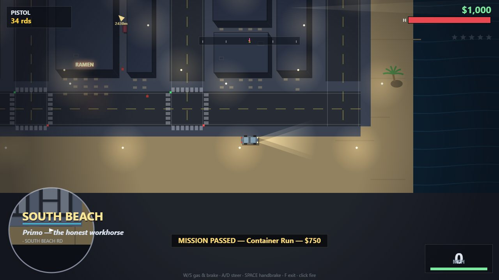
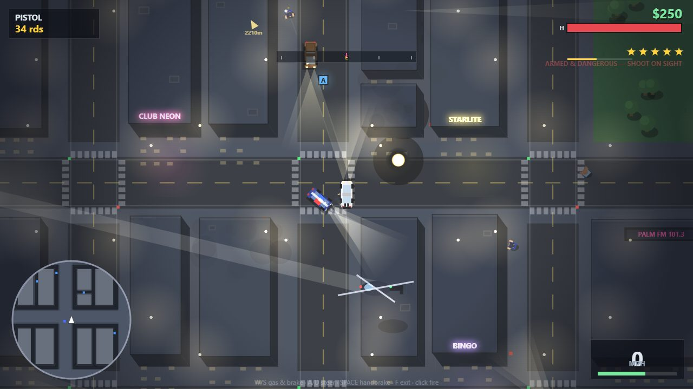

[](https://make.fun/bounty/gta6-01?utm_source=github&utm_medium=readme&utm_campaign=gta6-01)
[](https://make.fun/bounty/gta6-01/leaderboard?utm_source=github&utm_medium=readme&utm_campaign=gta6-01)
[](https://make.fun/bounty/gta6-01?utm_source=github&utm_medium=readme&utm_campaign=gta6-01)

# VICE PALMS — a night in the neon city

A top-down open-city crime playground in the GTA 1/2 tradition, built from
scratch in vanilla JavaScript + Canvas 2D + WebAudio. No engines, no
libraries, no network — everything is drawn and synthesized in code.

## Play

```bash
npm run serve        # → http://localhost:8080   (node serve.ts)
```

`serve.ts` is a zero-dependency Node 22 stdlib static server (`--port N` to
move off 8080). Open the URL, press ENTER, cause trouble.

## The city

A 4096×4096 night map, seeded and fully deterministic:

- **Downtown** — 9×7 road grid with traffic lights, crosswalks and a working
  intersection signal cycle; extruded buildings with lit windows, rooftop AC
  units, glowing billboards and flickering neon signage.
- **Memorial Park** — pond, fountain, flowerbeds, benches, and enough trees
  to hide behind.
- **North Docks** — container yards, working cranes, moored cargo ship, two
  public piers you can walk and drive.
- **Palm Airfield** — lit runway, three hangars, control tower, one very
  stealable supercar.
- **Ocean Drive & the beaches** — boardwalk, umbrellas, towels, strollers,
  and water you can swim in (the Atlantic always wins eventually).

## Systems

- **Driving** — arcade physics with a 4-speed auto gearbox, speed-sensitive
  steering, handbrake drifts, per-corner collisions, damage that pulls the
  steering, saps top speed, catches fire and finally explodes.
- **Traffic** — lane-following AI with individual driver personalities,
  signal obedience, queueing, pedestrian braking, turn signals and
  stuck-reversal recovery.
- **Pedestrians** — walkers, joggers, dog walkers, beach strollers; they
  chatter, panic, scream, flee, get run over and report your crimes.
- **The heat** — wanted 1–5: ramming cruisers at 1★, foot cops that shoot at
  2★, roadblocks with cones at 3★, the helicopter and its searchlight at 4★.
  Out-of-sight decay, WASTED/BUSTED, respawn fees, and a safehouse respray
  that cools the paint and the heat.
- **Missions** — six chained story missions (Rico returns to Vice Palms) with
  letterboxed cutscenes, plus three repeatable side hustles: Taxi Dash,
  Rampage and Special Delivery. Timers, checkpoints, fail/retry, payouts.
- **Audio** — everything synthesized: engine, gearbox, gunfire, sirens,
  explosions, skids, footsteps, seagull-adjacent ocean ambience, thunder,
  a helicopter rotor, and a 4-station pattern-sequenced radio (R to switch).
- **Rain** — a deterministic clear → drizzle → storm cycle with lightning,
  thunder, puddles, wet-road sheen and grip loss.
- **The rest** — pistol + fists with mouse aiming, health/armour/ammo/cash
  pickups, a circular minimap, a full TAB city chart, F1 street manual,
  localStorage save/continue/delete, and a deterministic staged-scene system
  for screenshots (`?shot=start|play|end|chaos&seed=N`).

## Screenshots

| | |
|---|---|
|  |  |
|  |  |

## Repo layout

```
game/            the entire game (index.html + src/*.js, vanilla ES modules)
serve.ts         static server for game/ on :8080
main.ts          make.fun packager: copies game/ + screenshots/, writes dossier.json
shots.json       the four staged screenshot entries
vendor/          make.fun kit (untouched)
screenshots/     1-start / 2-play / 3-end / 4-chaos (1280×720 JPEG ≤ 256 KiB)
```

## Build & verify

```bash
node serve.ts --port 8080          # serve the game
mkdir out; $env:MAKEFUN_OUTPUT_DIR="out"; node main.ts   # build dossier.json
```

## Controls

| Input | Action |
|---|---|
| WASD | move / drive |
| SHIFT | sprint (stamina) |
| F | enter / exit / carjack |
| Mouse + click | aim + fire (pistol), fists up close |
| 1 / 2 | fists / pistol |
| SPACE | handbrake (in car), attack (on foot) |
| H | horn / siren |
| R | radio station |
| TAB | city chart |
| F1 | street manual |
| M | mute |
| ESC | pause (save / delete save / quit) |

## License

See [LICENSE](LICENSE).
