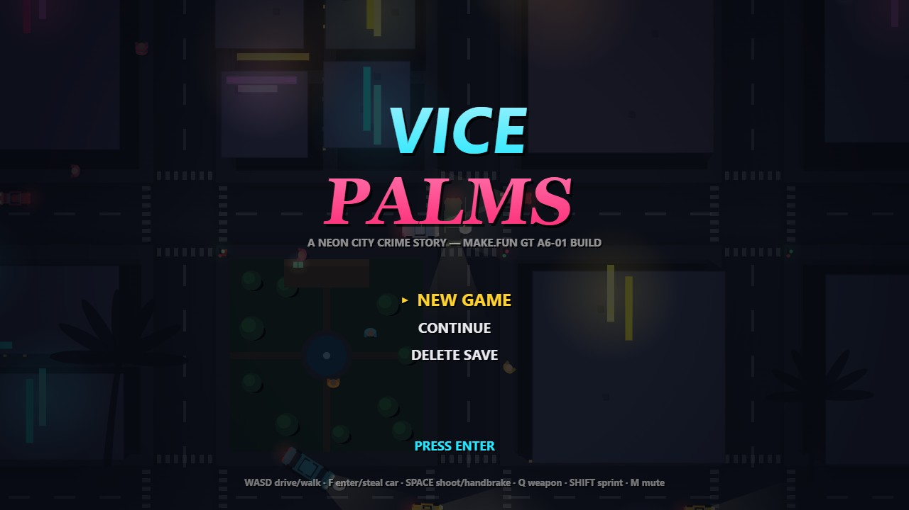

[](https://make.fun/bounty/gta6-01?utm_source=github&utm_medium=readme&utm_campaign=gta6-01)
[](https://make.fun/bounty/gta6-01/leaderboard?utm_source=github&utm_medium=readme&utm_campaign=gta6-01)
[](https://make.fun/bounty/gta6-01?utm_source=github&utm_medium=readme&utm_campaign=gta6-01)

# Vice Palms

A neon-soaked, top-down open-city crime story in the classic 1986 style — built from scratch
with zero libraries, zero assets and zero network calls. One HTML file, a pile of ES modules,
a `<canvas>`, and a very patient city.



## The city

- **A 6.4 km² night city** on a 400 px road grid: downtown towers, west beach and shoreline,
  a central park, **North Docks** (piers, container stacks, gantry cranes, a moored freighter)
  and **Palm Airfield** (runway, hangars, control tower). Everything is generated from a seed,
  so the whole city is deterministic.
- Faux-3D parallax buildings with lit windows, neon signage, street lamps, crosswalks and
  working traffic lights.
- Wet-road sheen, headlight cones, siren strobes, explosion flashes and a vignette — all drawn
  in an additive glow pass.

## The game

- **8 vehicles** (Sedan, Cheetah, Cabbie, Pony, Barracks, Coach, Cruiser, Stretch) with arcade
  drift physics, handbrake slides, damage → smoke → fire → explosion, and headlights.
- **Carjack anything** (F), run from the law or ram it: 5 wanted stars, pursuit cruisers that
  ram and PIT you, roadblocks at 3 stars, foot cops that bail out and shoot, out-of-sight heat
  decay, WASTED/BUSTED with hospital bills.
- **6 chained story missions** (Rico returns to Vice Palms) plus 3 side hustles — Vice Cab
  fares, Wrecking Crew, Air Mail — with markers, timers, payouts and auto-save.
- **Peds** wander the sidewalks and scatter when you go loud. Fists and a pistol with ammo,
  health/armor pickups, cash drops.
- **Synthwave soundtrack** plus engine, siren, gunfire and explosion sounds, all synthesized
  live with WebAudio (press **M** to mute).

## Run it

```bash
node serve.ts            # http://localhost:8080
node serve.ts --port 9000
```

Requires Node 22+. Or any static file server pointed at `game/`.

## Controls

| Key | Action |
| --- | --- |
| WASD / arrows | drive / walk |
| Shift | sprint |
| F | enter / exit / steal a car |
| Space (on foot) / click | shoot |
| Space (in car) | handbrake |
| Q | switch weapon |
| Esc / P | pause, save |
| M | mute |

## Build

```bash
mkdir out
$env:MAKEFUN_OUTPUT_DIR="out"   # bash: export MAKEFUN_OUTPUT_DIR=out
node main.ts
```

Stages `game/` + `screenshots/` into the output directory and writes `dossier.json`.

## Layout

```
game/index.html        entry page
game/src/main.js       boot + loop
game/src/game.js       state machine, FX, bullets, pickups, save data
game/src/world.js      seeded city generator + collision
game/src/cars.js       vehicle specs + arcade physics + explosions
game/src/traffic.js    lane AI, lights, queueing, mission cars
game/src/player.js     on-foot movement, carjacking, weapons
game/src/peds.js       pedestrians
game/src/police.js     wanted system, pursuit, roadblocks, foot cops
game/src/missions.js   story + side missions
game/src/render.js     renderer + glow + minimap
game/src/hud.js        HUD
game/src/screens.js    title / pause / wasted
game/src/shots.js      staged screenshot scenes (?shot=start|play|end|chaos)
serve.ts               static dev server
main.ts                dossier build step
```
